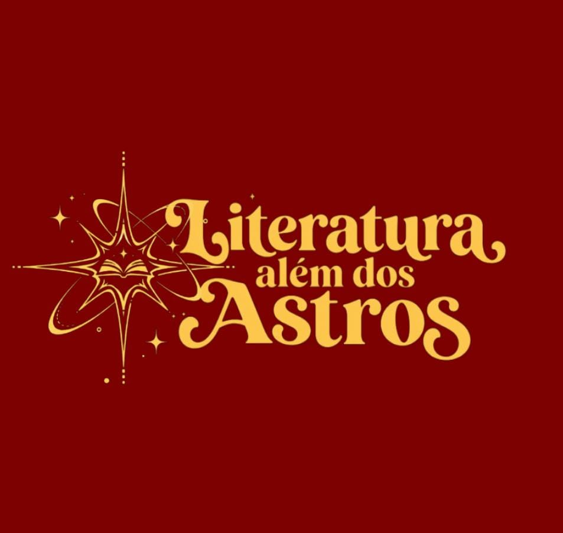

# Literatura Além dos Astros

# Site sobre literatura, de uma maneira acessível e divertida

Nosso site foi feito para que usuários pudessem compartilhar com outros seu gosto por leitura, sem serem amarrados a preços absurdos
ou taxas, sendo apenas ligados pelo seu amor por livros e cultura pop.

# Objetivo

O site foi feito como parte de um projeto de inovação, onde cada aluno deveria criar algo novo e diferente entre si. Para isso, devíamos utilizar
tudo que sabíamos.

# Linguagens utilizadas

Utilizamos JavaScript, no ambiente de execução Node.JS, e usamos o SQLite como banco de dados.

# Como usar/acessar?

Baixe o repositório do GitHub e descompacte a pasta, depois, inicialize propriamente o servidor utilizando:

node server.js

Depois disso, utilize o link http://localhost:3000/html/ para acessar a página principal

ou acesse o link do render!! https://literatura-alem-dos-astros.onrender.com

# Integrantes

Alice Marion Medeiros Sant'ana
Antonia Alice Vassao Oliveira
Ciely Pereira da Silva
Laura Sales
